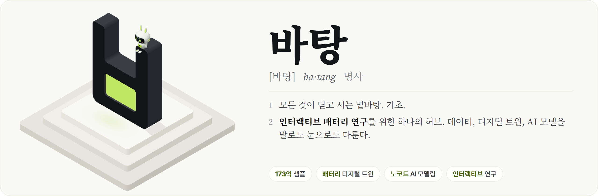
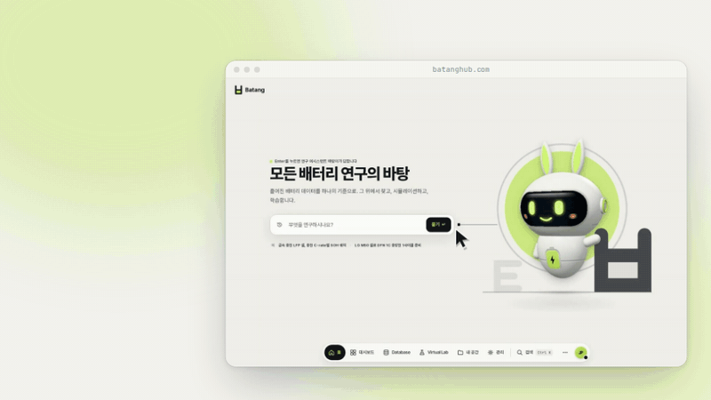
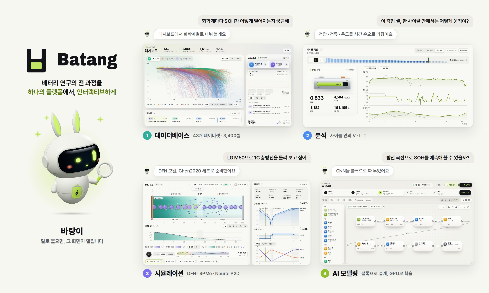
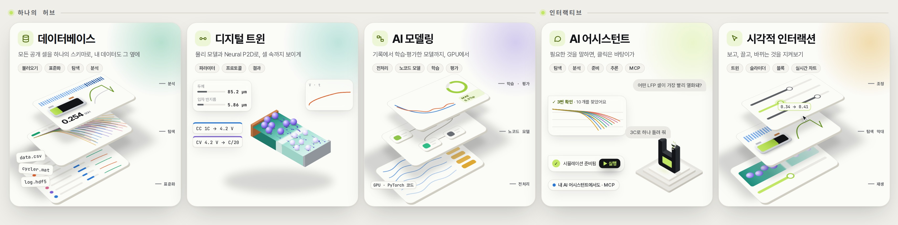

<div align="center">

<a href="https://batanghub.com">
  <picture>
    <source media="(prefers-color-scheme: dark)" srcset="docs/assets/ko/banner-dark.png">
    
  </picture>
</a>

[English](README.md) | **한국어**

<p>
  <a href="https://batanghub.com"></a>
  
  <a href="DATASETS.md"></a>
  <a href="DATASETS.md"></a>
</p>

<p>
  <a href="https://batanghub.com"><b>Batang 열기</b></a> ·
  <a href="#-하나의-허브--인터랙티브">하나의 허브 × 인터랙티브</a> ·
  <a href="#-기능">기능</a> ·
  <a href="#-데이터">데이터</a> ·
  <a href="#-인용">인용</a> ·
  <a href="#license">라이선스</a>
</p>

</div>

**Batang**(바탕)은 배터리 연구의 전 과정을 위한 **하나의 허브**이고, **인터랙티브**하게 쓰도록 만들었습니다. 데이터를
불러와 표준화하고, 살펴보고 분석하고, 셀을 시뮬레이션하고 AI 모델을 학습시키는 일을 모두 한곳에서, 하나의 스키마
위에서 합니다. 모든 단계를 연구 어시스턴트 바탕이와 함께 **말로**, 또는 디지털 트윈과 슬라이더, 블록으로 **눈으로**
할 수 있습니다.

<p align="center">
  <a href="https://batanghub.com"></a>
</p>

> [!NOTE]
> [batanghub.com](https://batanghub.com/signup)에서 Google 계정으로 가입하면 누구나 바로 쓸 수 있습니다. 가입하면 Virtual Lab
> 크레딧을 받고, 매달 다시 채워집니다.

## 💬 하나의 허브 × 인터랙티브

<p align="center">
  <picture>
    <source media="(prefers-color-scheme: dark)" srcset="docs/assets/ko/overview-dark.jpg">
    
  </picture>
</p>

**하나의 허브.** 배터리 연구는 보통 흩어져 있습니다. 데이터셋은 이 스크립트로 정리하고, 전처리와 학습은 또 다른
코드에서, 그림은 노트북에서 그리고, 시뮬레이터는 따로 설정합니다. Batang에서는 이 루프 전체가 한곳에서, 하나의
스키마와 하나의 계산 서버 위에서 돌아갑니다. 앞 단계가 만든 것을 다음 단계가 그대로 읽습니다.

**인터랙티브.** 모든 단계는 말을 걸 수 있고, 눈으로 볼 수 있습니다. 바탕이에게 물으면 데이터를 찾고, 차트로
그리고, 설명하고, 말한 대로 실행을 준비해 줍니다. 또는 슬라이더를 움직이며 P2D 트윈 속 전극을 지켜보고, 블록으로
모델을 엮어 학습되는 모습을 지켜볼 수 있습니다.

## ✨ 기능

<p align="center">
  <picture>
    <source media="(prefers-color-scheme: dark)" srcset="docs/assets/ko/interaction-dark.jpg">
    
  </picture>
</p>

| | |
|---|---|
| 🗄️ **데이터베이스** | 공개 노화 데이터셋 43개와 팩·차량·고장 데이터셋 11개를 셀 하나하나 같은 스키마로 변환했습니다. 탐색하고, 거르고, 비교하고, 내 사이클러 파일도 그 옆에 놓을 수 있습니다. |
| 🔋 **디지털 트윈** | PyBaMM(SPM, SPMe, DFN)과 DFN의 GPU 대리 모델인 Neural P2D로 43개 파라미터 세트의 셀을 시뮬레이션하고, 입자·전해질·리튬을 P2D 트윈으로 다시 재생합니다. |
| 🧠 **AI 모델링** | 기록을 전처리하고, 블록으로 신경망을 만들고, 학습되는 모습을 보며 GPU에서 학습시키고, 새 데이터로 평가합니다. 고른 설정은 PyTorch 코드로 가져갈 수 있습니다. |
| 💬 **AI 어시스턴트** | 바탕이가 데이터를 찾고, 대화 속에 차트를 그리고, 알맞은 화면을 설정까지 해서 열어 줍니다. Claude 같은 내 어시스턴트도 MCP로 같은 데이터에 닿습니다. |
| 🎛️ **시각적 인터랙션** | 트윈, 파라미터 슬라이더, 노코드 블록, 실시간 학습 곡선: 모든 단계를 계산만 하지 않고 보여 줍니다. |

## 📦 데이터

릴리스 2.0에는 **3,400셀**(리튬이온, 소듐이온, 아연이온, 1,000만 사이클, 170억 샘플)과 **1,513장치**(3.36억 샘플)가
각 출처의 원래 시간 해상도 그대로 들어 있습니다. 모든 기록을 하나씩 변환하고 점검했습니다. 열 이름 규칙 하나, 사이클
정의 하나, SOH 정의 하나를 쓰고, 아무것도 지우지 않았으며, 출처의 라이선스를 데이터와 함께 둡니다.

- [DATASETS.md](DATASETS.md): 데이터셋마다 출처, 라이선스, 인용할 논문
- [DATA_FORMAT.md](DATA_FORMAT.md): 열 하나하나까지의 스키마
- [client/](client): 승인된 다운로드를 위한 Python 패키지

Batang은 원본 데이터를 재배포하지 않습니다. 원 측정값은 각 출처에서, 그 조건에 따라 받습니다.

## 📜 인용

Batang을 쓰셨다면 Batang과 **함께 쓴 원 데이터셋을** 인용해 주세요([DATASETS.md](DATASETS.md),
[`docs/references.bib`](docs/references.bib)).

```bibtex
@misc{park2026batang,
  author = {Park, Jimin},
  title  = {{Batang}: An Open Hub for Battery Data, Simulation and {AI} Modeling},
  year   = {2026},
  url    = {https://batanghub.com},
  note   = {Release 2.0}
}
```

<a id="license"></a>

## ⚖️ 라이선스

- **데이터**는 원 출처의 라이선스를 그대로 따르며, [DATASETS.md](DATASETS.md)에 데이터셋마다 상업적 이용 가능
  여부와 함께 적혀 있습니다. Batang은 어떤 데이터셋도 다시 라이선스하지 않습니다. 라이선스를 밝히지 않은 출처는
  인용과 함께 연구에만 쓰고, 그 이상은 저자에게 먼저 물어 주세요.
- **이 문서**: [CC BY 4.0](LICENSE). [`client/`](client)의 **Python 패키지**: MIT.

## 🙏 감사의 글

이 프로젝트를 지원해 주신 연세대학교 최정일 교수님과 [Multi-Physics Modeling & Computation Lab(MPMC)](https://www.mpmc.yonsei.ac.kr/)에
감사드립니다. Batang은 [DATASETS.md](DATASETS.md)에 실린 연구 그룹들이 측정값을 공개했기에 존재할 수 있습니다.

<br>

<div align="center">
  <a href="https://batanghub.com">
    <picture>
      <source media="(prefers-color-scheme: dark)" srcset="docs/assets/batang-mark-dark.svg">
      
    </picture>
  </a>
  <br>
  <sub>개발·운영 박지민 · <a href="https://batanghub.com">batanghub.com</a> · <a href="mailto:support@batanghub.com">support@batanghub.com</a></sub>
</div>
