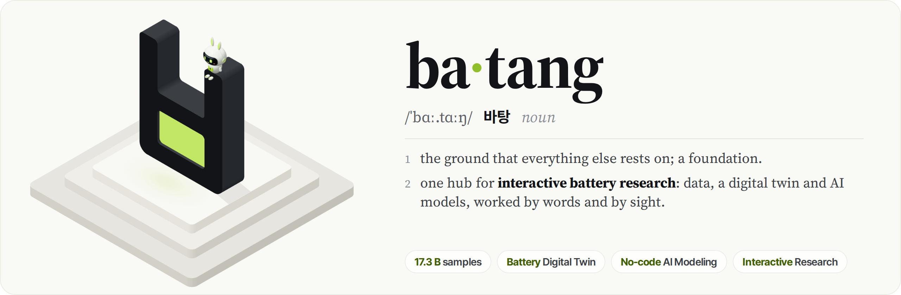
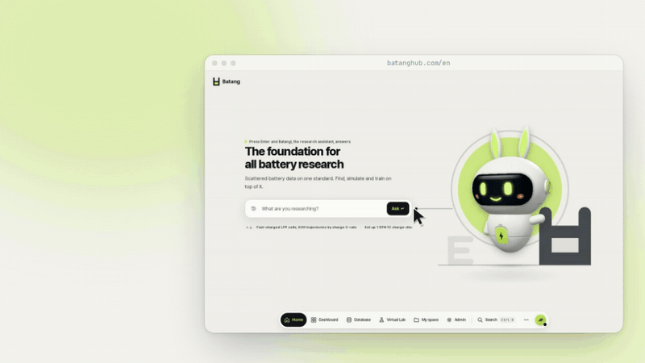

<div align="center">

<a href="https://batanghub.com/en">
  <picture>
    <source media="(prefers-color-scheme: dark)" srcset="docs/assets/en/banner-dark.png">
    
  </picture>
</a>

**English** | [한국어](README.ko.md)

<p>
  <a href="https://batanghub.com/en"></a>
  
  <a href="DATASETS.md"></a>
  <a href="DATASETS.md"></a>
</p>

<p>
  <a href="https://batanghub.com/en"><b>Open Batang</b></a> ·
  <a href="#-one-hub--interactive">One hub × interactive</a> ·
  <a href="#-features">Features</a> ·
  <a href="#-data">Data</a> ·
  <a href="#-citation">Citation</a> ·
  <a href="#license">License</a>
</p>

</div>

**Batang** (바탕, *foundation*) is **one hub** for the whole battery research pipeline, made to be used
**interactively**. Load and standardize data, explore and analyze it, simulate cells and train AI models, all in one
place on one schema. Every step can be done **by words**, with Batangi the research assistant, or **by sight**, with a
digital twin, sliders and blocks.

<p align="center">
  <a href="https://batanghub.com/en"></a>
</p>

> [!NOTE]
> Sign up at [batanghub.com](https://batanghub.com/signup?lang=en) with any Google account and start right away. Virtual Lab
> credits come with the sign-up and are topped up every month.

## 💬 One hub × interactive

<p align="center">
  <picture>
    <source media="(prefers-color-scheme: dark)" srcset="docs/assets/en/overview-dark.jpg">
    
  </picture>
</p>

**One hub.** Battery research is usually scattered: a dataset cleaned with one script, preprocessing and training in
others, plots in a notebook, a simulator with its own setup. In Batang the whole loop runs in one place, on one schema
and one set of compute servers, so what one step produces is what the next one reads.

**Interactive.** Every step is something you can talk to and something you can see. Ask Batangi and it finds the
data, charts it, explains it and sets up the run you describe. Or watch the electrode in a P2D twin while you move
the sliders, and wire models from blocks and watch them learn.

## ✨ Features

<p align="center">
  <picture>
    <source media="(prefers-color-scheme: dark)" srcset="docs/assets/en/interaction-dark.jpg">
    
  </picture>
</p>

| | |
|---|---|
| 🗄️ **Database** | 43 public ageing datasets and 11 pack, vehicle and fault datasets, converted cell by cell into one schema. Explore, filter and compare them, and add your own cycler files beside them. |
| 🔋 **Digital twin** | Simulate cells with PyBaMM (SPM, SPMe, DFN) and Neural P2D, a GPU surrogate of DFN, on 43 parameter sets, and replay particles, electrolyte and lithium in a P2D twin. |
| 🧠 **AI modeling** | Preprocess records, build a network from blocks, train it on a GPU while watching it learn, and evaluate it on new data. The choices become PyTorch code to take home. |
| 💬 **AI assistant** | Batangi finds data, draws charts in the chat and opens the right screen, set up for you. Your own assistant, such as Claude, reaches the same data over MCP. |
| 🎛️ **Visual interaction** | The twin, parameter sliders, no-code blocks and live training curves: every step is shown, not only computed. |

## 📦 Data

Release 2.0 holds **3,400 cells** (Li-ion, Na-ion, Zn-ion) with 10.0 M cycles and 17.0 G samples, and **1,513
devices** with 336 M samples, at each source's own time resolution. Every record was converted and checked one by
one: one column naming rule, one cycle definition, one SOH definition, nothing deleted, and the source's license kept
with the data.

- [DATASETS.md](DATASETS.md): every dataset with its source, license and the article to cite
- [DATA_FORMAT.md](DATA_FORMAT.md): the schema, column by column
- [client/](client): the Python package for approved downloads

Batang does not redistribute raw data. The original measurements come from each source, under its terms.

## 📜 Citation

If you use Batang, please cite it **and the original datasets you use** ([DATASETS.md](DATASETS.md),
[`docs/references.bib`](docs/references.bib)).

```bibtex
@misc{park2026batang,
  author = {Park, Jimin},
  title  = {{Batang}: An Open Hub for Battery Data, Simulation and {AI} Modeling},
  year   = {2026},
  url    = {https://batanghub.com},
  note   = {Release 2.0}
}
```

<a id="license"></a>

## ⚖️ License

- **Data** keeps the license of its original source, listed per dataset in [DATASETS.md](DATASETS.md) with whether
  commercial use is allowed. Batang does not relicense any dataset. Where a source states no license, use it for
  research with citation and ask its authors before anything more.
- **This documentation**: [CC BY 4.0](LICENSE). **The Python package** in [`client/`](client): MIT.

## 🙏 Acknowledgements

I thank Prof. Jung-Il Choi and the [Multi-Physics Modeling & Computation Lab (MPMC)](https://www.mpmc.yonsei.ac.kr/),
Yonsei University, for supporting this project. Batang exists only because the groups listed in
[DATASETS.md](DATASETS.md) published their measurements openly.

<br>

<div align="center">
  <a href="https://batanghub.com/en">
    <picture>
      <source media="(prefers-color-scheme: dark)" srcset="docs/assets/batang-mark-dark.svg">
      
    </picture>
  </a>
  <br>
  <sub>Developed and maintained by Jimin Park · <a href="https://batanghub.com/en">batanghub.com</a> · <a href="mailto:support@batanghub.com">support@batanghub.com</a></sub>
</div>
